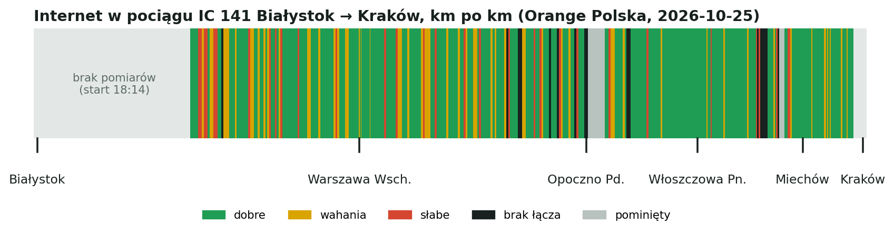
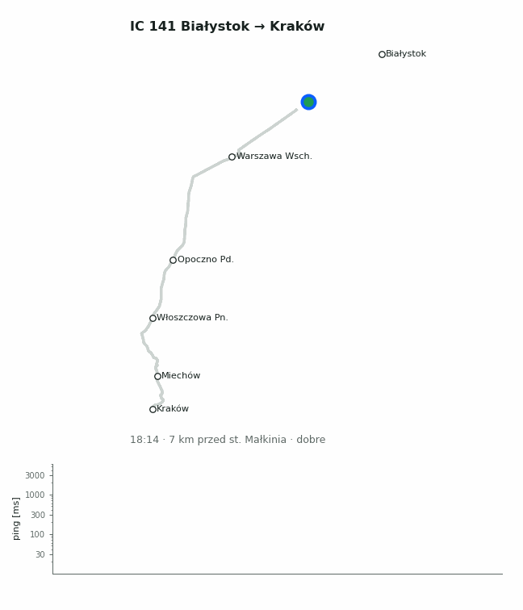

# rail-coverage-pl

**How good is mobile internet on Polish trains, kilometre by kilometre?**

This project measures it from the passenger seat: a laptop on the phone's hotspot sends
10 pings every 30 seconds, and each measurement is placed on the route from the phone's
GPS track or, without GPS, from the train timetable. Base stations near the line come
from the official UKE radio permit lists, so you can see whether the dead zones line up
with gaps in the network.





**Map:** https://kprzybys.github.io/rail-coverage-pl/ · **First trip report (PL):** [IC 141 Białystok → Kraków](trips/2026-10-25-ic141-bialystok-krakow/report.md)

## Who is this for

- **Passengers who work on the train.** Know where the 2-second lag and the dead zones are
  before you schedule a call or start a big upload.
- **People comparing operators.** Each trip records the network; with more trips the same
  route can be compared across Orange, T-Mobile, Plus and Play.
- **Rail operators and mobile networks.** A public, reproducible record of where coverage
  along the busiest lines fails, with the nearest permitted base station for each gap.
- **Journalists and researchers.** Raw CSV data, a documented method, and code that
  rebuilds every chart.

## How it works

| Step | Tool | Output |
|---|---|---|
| Log ping every 30 s | `railcov/logger.sh` | `ping.csv` |
| Describe the trip (train, timetable, delays, network) | edit `trip.json` | `trip.json`, `stations.json` |
| Import the phone's GPS track, clipped station to station | `python -m railcov.gpx` | `track.gpx` |
| Base stations within 8 km of the route (UKE) | `python -m railcov.bts` | `bts.json` |
| Charts and report | `python -m railcov.report` | `figures/*.png`, `report.md` |
| Route strip and replay GIF for sharing | `python -m railcov.promo` | `figures/strip.png`, `figures/replay.gif` |
| Website: replay, chart, strip, longest gaps | `python -m railcov.site` | `site/` (GitHub Pages) |
| All of the above after a trip | `./finish.sh trips/<trip-id> [recording.gpx]` | |

```bash
pip install -r requirements.txt
railcov/logger.sh trips/<trip-id>/ping.csv          # during the trip; Ctrl+C at the end
python -m railcov.gpx    trips/<trip-id> ~/Downloads/recording.gpx
python -m railcov.bts    trips/<trip-id>
python -m railcov.report trips/<trip-id>
python -m railcov.site
```

Quality grades (thresholds for interactive use such as SSH and calls):

| Grade | Rule |
|---|---|
| good | no loss, average < 100 ms, max ≤ 200 ms |
| weak | some loss, or average ≥ 100 ms, or a spike over 200 ms |
| bad | loss ≥ 30% or average ≥ 300 ms |
| dead | 100% loss |

Details and limits: [docs/methodology.md](docs/methodology.md) · data format: [docs/data-format.md](docs/data-format.md).

## Contribute a trip

The most useful contribution is **another trip**: a different line, a different operator,
the same line at a different time. See [CONTRIBUTING.md](CONTRIBUTING.md). Android phones
can also log signal strength and cell IDs, which would turn "where is it bad" into "why".

## License

Code: MIT. Measurements: CC BY 4.0. Station coordinates: © OpenStreetMap contributors (ODbL).
Base station locations: UKE public register. See [LICENSE](LICENSE) and [DATA-LICENSE.md](DATA-LICENSE.md).

---

## Po polsku

**Jak działa mobilny internet w polskich pociągach, kilometr po kilometrze?**

Laptop podłączony do hotspotu w telefonie co 30 sekund wysyła 10 pingów. Każdy pomiar
trafia na trasę według śladu GPS z telefonu albo, bez GPS, według rozkładu jazdy. Do tego
dochodzą stacje bazowe z wykazu pozwoleń UKE, więc widać, czy martwe strefy pokrywają się
z dziurami w sieci.

Pierwszy przejazd: **IC 141 Hańcza, Białystok → Kraków Główny, 25.10.2026, sieć Orange**,
[raport](trips/2026-10-25-ic141-bialystok-krakow/report.md).

**Komu to się przyda:** pasażerom pracującym w pociągu (gdzie nie planować rozmowy),
osobom wybierającym operatora, przewoźnikom i operatorom komórkowym (publiczna mapa
problemów na najważniejszych liniach) oraz dziennikarzom i badaczom (surowe dane i kod).

**Jak pomóc:** nagraj własny przejazd, inną linią albo w innej sieci, i wyślij pull request.
Instrukcja jest w [CONTRIBUTING.md](CONTRIBUTING.md). Szczególnie cenne są pomiary z
telefonów z Androidem, które zapisują siłę sygnału i identyfikator komórki.
