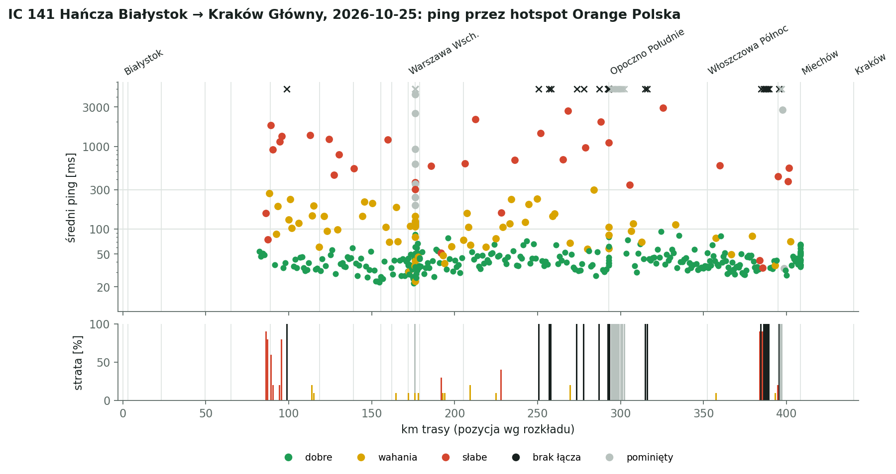
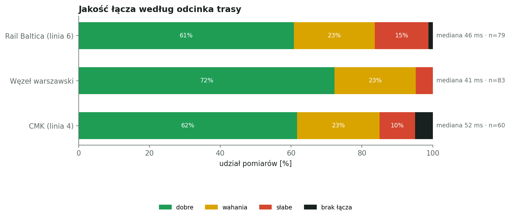
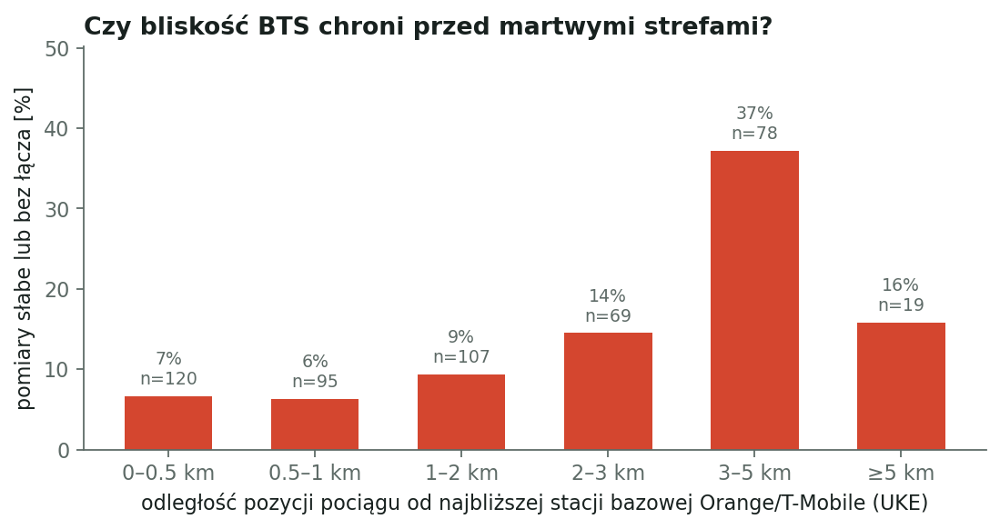

# IC 141 Hańcza: Białystok → Kraków Główny, 2026-10-25

Pomiar jakości mobilnego internetu w pociągu: hotspot iPhone, hotspot Wi-Fi 2,4 GHz, sieć Orange Polska. ping -c 10 -i 0.3 -W 2 co 30 s do 1.1.1.1. Pozycja pociągu z rozkładu jazdy i śladu GPS.

## Najważniejsze liczby

- pomiarów: **488** (+36 pominiętych jako zakłócone)
- dobre łącze: **71%** pomiarów, wahania 16%, słabe 8%, brak łącza 6%
- mediana średniego pingu: **42 ms**, 90. percentyl: 157 ms
- odcinków słabych lub bez łącza: **41**

## Odcinki trasy

| Odcinek | Pomiary | Dobre | Słabe + brak | Mediana pingu |
|---|---:|---:|---:|---:|
| Rail Baltica (linia 6) | 79 | 61% | 16% | 46 ms |
| Węzeł warszawski | 83 | 72% | 5% | 41 ms |
| CMK (linia 4) | 155 | 64% | 20% | 47 ms |
| CMK płd. i linia 8 do Krakowa | 171 | 80% | 11% | 37 ms |

## Martwe i słabe strefy

| Czas | Gdzie (km) | Najgorszy pomiar | Najbliższy BTS |
|---|---|---|---|
| 18:16–18:17 | 3 km przed st. Małkinia (km 86) | 157 ms, strata 90% | Orange 0.92 km (Kańkowo) |
| 18:18 | Małkinia (km 89) | 1811 ms, strata 60% | Orange 2.15 km (Kańkowo) |
| 18:21 | 6 km za st. Małkinia (km 95) | 1338 ms, strata 80% | T-Mobile 2.16 km (Orzełek) |
| 18:23 | 10 km za st. Małkinia (km 99) | 100% strat | T-Mobile 2.32 km (Orzełek) |
| 18:30 | 5 km przed st. Łochów (km 113) | 1377 ms, strata 0% | Orange 1.12 km (Ostrówek) |
| 18:35 | 6 km za st. Łochów (km 124) | 1220 ms, strata 0% | Orange 0.81 km (Tłuszcz) |
| 18:37 | 9 km za st. Łochów (km 127) | 454 ms, strata 0% | T-Mobile 1.46 km (Tłuszcz) |
| 18:38 | 9 km przed st. Tłuszcz (km 130) | 794 ms, strata 0% | Orange 1.46 km (Klembów) |
| 18:43 | Tłuszcz (km 139) | 539 ms, strata 0% | T-Mobile 0.68 km (Wołomin) |
| 18:52 | 2 km przed st. Zielonka (km 160) | 1209 ms, strata 0% | Orange 1.08 km (Warszawa) |
| 19:08 | Warszawa Centralna (km 176) | 367 ms, strata 10% | Orange 0.05 km (Warszawa) |
| 19:23 | Warszawa Centralna (km 176) | 303 ms, strata 0% | Orange 0.11 km (Warszawa) |
| 19:38 | 7 km za st. Warszawa Zachodnia (km 186) | 581 ms, strata 0% | Orange 0.47 km (Warszawa) |
| 19:41 | 13 km za st. Warszawa Zachodnia (km 192) | 51 ms, strata 30% | T-Mobile 0.23 km (Piastów) |
| 19:48 | 1 km za st. Grodzisk Mazowiecki (km 206) | 623 ms, strata 0% | Orange 0.59 km (Grodzisk Mazowiecki) |
| 19:51 | 7 km za st. Grodzisk Mazowiecki (km 212) | 2144 ms, strata 0% | Orange 1.45 km (Jaktorów) |
| 19:58 | 23 km za st. Grodzisk Mazowiecki (km 228) | 158 ms, strata 40% | T-Mobile 1.1 km (Zawady) |
| 20:02 | 31 km za st. Grodzisk Mazowiecki (km 236) | 685 ms, strata 0% | T-Mobile 3.51 km (Żurawka) |
| 20:09–20:10 | 42 km przed st. Opoczno Południe (km 251) | 100% strat | T-Mobile 3.42 km (Lewin) |
| 20:12–20:13 | 36 km przed st. Opoczno Południe (km 257) | 100% strat | Orange 2.99 km (Gustawów) |
| 20:16 | 28 km przed st. Opoczno Południe (km 265) | 693 ms, strata 0% | T-Mobile 1.76 km (Brudzewice) |
| 20:18 | 24 km przed st. Opoczno Południe (km 268) | 2685 ms, strata 0% | Orange 0.59 km (Giełzów) |
| 20:20 | 19 km przed st. Opoczno Południe (km 274) | 100% strat | T-Mobile 1.6 km (Idzikowice) |
| 20:22–20:23 | 15 km przed st. Opoczno Południe (km 278) | 100% strat | T-Mobile 3.02 km (Idzikowice) |
| 20:27 | 6 km przed st. Opoczno Południe (km 287) | 100% strat | Orange 3.42 km (Opoczno) |
| 20:29–20:32 | Opoczno Południe (km 292) | 100% strat | T-Mobile 3.14 km (Opoczno) |
| 20:33 | Opoczno Południe (km 293) | 100% strat | Orange 3.52 km (Opoczno) |
| 20:35 | Opoczno Południe (km 293) | 100% strat | Orange 3.65 km (Opoczno) |
| 20:39–20:40 | Opoczno Południe (km 293) | 100% strat | Orange 3.91 km (Opoczno) |
| 20:46 | 13 km za st. Opoczno Południe (km 305) | 342 ms, strata 0% | Orange 4.09 km (Sielec) |
| 20:50–20:51 | 22 km za st. Opoczno Południe (km 315) | 100% strat | T-Mobile 3.51 km (Fałków) |
| 20:55 | 27 km przed st. Włoszczowa Północ (km 326) | 2937 ms, strata 0% | T-Mobile 1.65 km (Adelinów) |
| 21:14 | 8 km za st. Włoszczowa Północ (km 360) | 588 ms, strata 0% | Orange 2.16 km (Wałkonowy Dolne) |
| 21:30–21:33 | 11 km przed st. Kozłów (km 384) | 100% strat | T-Mobile 3.54 km (Stary Węgrzynów) |
| 21:37 | Kozłów (km 395) | 100% strat | Orange 3.65 km (Uniejów-Kolonia) |
| 21:41 | 6 km za st. Kozłów (km 401) | 550 ms, strata 0% | Orange 2.78 km (Strzeżów Pierwszy) |
| 22:26 | Kraków Główny (km 440) | 735 ms, strata 0% | T-Mobile 1.01 km (Kraków) |
| 22:28 | Kraków Główny (km 440) | 918 ms, strata 0% | T-Mobile 0.17 km (Kraków) |
| 22:29 | Kraków Główny (km 440) | 329 ms, strata 0% | T-Mobile 0.64 km (Kraków) |
| 22:31 | Kraków Główny (km 440) | 661 ms, strata 10% | Orange 0.48 km (Kraków) |
| 22:32 | Kraków Główny (km 440) | 389 ms, strata 0% | T-Mobile 0.11 km (Kraków) |

## Stacje bazowe a jakość

Odległość liczona od szacowanej pozycji pociągu do najbliższej lokalizacji z pozwoleniem UKE (LTE 800/1800/2100/2600, 5G 2100). Pozwolenie nie oznacza, że stacja działa ani że świeci w stronę torów.

## Zastrzeżenia

- Pominięto 19:09–19:21: zakłócenie pomiaru: laptop pobierał ok. 7 MB danych UKE przez to samo łącze (bufferbloat).
- Pominięto 20:40–20:45: hotspot w telefonie wyłączył się sam (NetworkManager: ssid-not-found 20:40:57, ponowne połączenie Wi-Fi 20:44:04); okno obejmuje też ok. 1 min po ponownym połączeniu.
- Pominięto 21:38–21:39: hotspot w telefonie wyłączył się sam (NetworkManager: ssid-not-found 21:38:13, ponowne połączenie Wi-Fi 21:38:54); okno obejmuje też ok. 1 min po ponownym połączeniu.
- Od 19:30 przyjęto opóźnienie 2 min 0 s (obserwacja: postój na Warszawie Zachodniej ok. 19:34).
- Od 20:40 przyjęto opóźnienie 2 min 20 s (obserwacja: odjazd z Opoczna Południe zgłoszony przez pasażera).
- Od 21:09 przyjęto opóźnienie 2 min 13 s (obserwacja: odjazd z Włoszczowy Północ zgłoszony przez pasażera).
- Od 21:45 przyjęto opóźnienie 1 min 44 s (obserwacja: postój w Miechowie zgłoszony przez pasażera).
- Od 21:59 przyjęto opóźnienie 1 min 56 s (obserwacja: odjazd z Miechowa zgłoszony przez pasażera).
- Odpowiedź później niż 2 s liczy się jako strata.
- Bez GPS pozycja jest liczona przy stałej prędkości między postojami, po prostej między stacjami; błąd sięga kilku km.
- Jeden telefon, jedna sieć, jeden przejazd: to obserwacja, nie pomiar referencyjny.

## Dziennik podróży

- 19:11: potwierdzenie pasażera: postój na Warszawie Centralnej (perony podziemne)
- 19:34: potwierdzenie pasażera: postój na Warszawie Zachodniej
- 20:40: potwierdzenie pasażera: odjazd z Opoczna Południe
- 20:44: pasażer: hotspot w telefonie wyłączył się na kilka minut (potwierdzone w logu NetworkManager)
- 21:09: potwierdzenie pasażera: odjazd z Włoszczowy Północ
- 21:39: pasażer: hotspot znów wyłączył się na chwilę (potwierdzone w logu NetworkManager)
- 21:45: potwierdzenie pasażera: postój w Miechowie
- 21:59: potwierdzenie pasażera: odjazd z Miechowa
- 22:25: pasażer: nieplanowany postój ok. 1 km przed Krakowem Głównym
- 22:27: pasażer: telefon przełożony spod okna do środka przedziału (koniec standardowego ustawienia)
- 22:30: pasażer: pociąg ruszył po nieplanowanym postoju przed Krakowem Głównym
- 22:36: pasażer: przyjazd na Kraków Główny (opóźnienie ok. 12 min); koniec pomiaru
