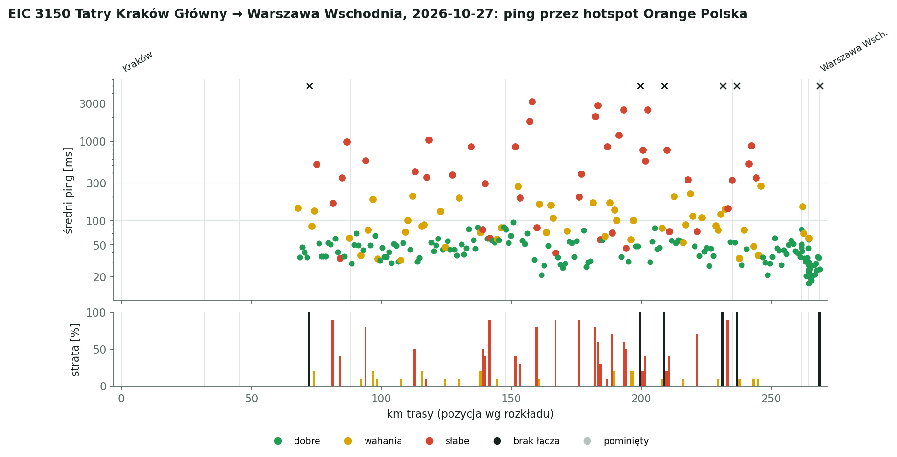
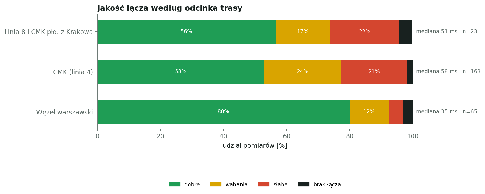
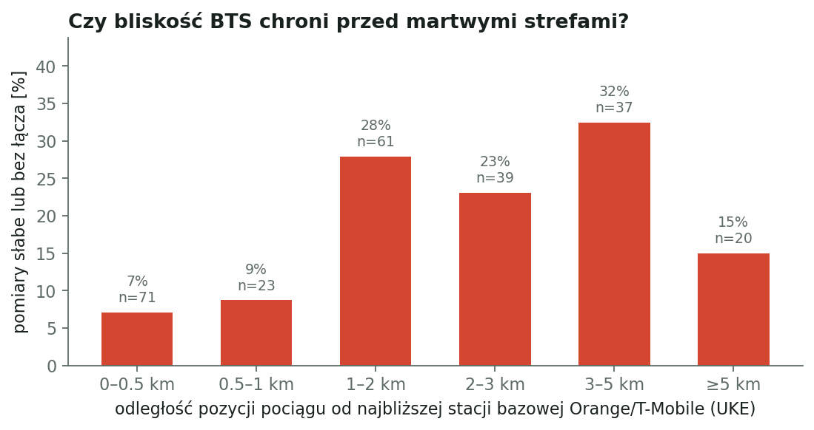

# EIC 3150 Tatry: Kraków Główny → Warszawa Wschodnia, 2026-10-27

Pomiar jakości mobilnego internetu w pociągu: hotspot router pokładowy pociągu, Wi-Fi 5 GHz (VHT 80 MHz, sygnał −47 dBm, 866 Mbit/s), sieć Orange Polska. ping -c 10 -i 0.3 -W 2 co 30 s do 1.1.1.1. Pozycja pociągu z rozkładu jazdy i śladu GPS.

## Najważniejsze liczby

- pomiarów: **251** (+0 pominiętych jako zakłócone)
- dobre łącze: **60%** pomiarów, wahania 21%, słabe 17%, brak łącza 2%
- mediana średniego pingu: **53 ms**, 90. percentyl: 330 ms
- odcinków słabych lub bez łącza: **34**

## Odcinki trasy

| Odcinek | Pomiary | Dobre | Słabe + brak | Mediana pingu |
|---|---:|---:|---:|---:|
| Linia 8 i CMK płd. z Krakowa | 23 | 56% | 26% | 51 ms |
| CMK (linia 4) | 163 | 53% | 23% | 58 ms |
| Węzeł warszawski | 65 | 80% | 8% | 35 ms |

## Martwe i słabe strefy

| Czas | Gdzie (km) | Najgorszy pomiar | Najbliższy BTS |
|---|---|---|---|
| 18:29 | 16 km przed st. Włoszczowa Północ (km 72) | 100% strat | Orange 3.41 km (Uniejów-Kolonia) |
| 18:30 | 13 km przed st. Włoszczowa Północ (km 75) | 514 ms, strata 0% | Orange 2.32 km (Kozłów) |
| 18:34 | 7 km przed st. Włoszczowa Północ (km 81) | 167 ms, strata 90% | Orange 1.83 km (Kozłów) |
| 18:35–18:36 | 4 km przed st. Włoszczowa Północ (km 84) | 34 ms, strata 40% | Orange 4.57 km (Kozłów) |
| 18:37 | 1 km przed st. Włoszczowa Północ (km 87) | 988 ms, strata 0% | Orange 5.31 km (Kozłów) |
| 18:41 | 6 km za st. Włoszczowa Północ (km 94) | 572 ms, strata 80% | Orange 4.13 km (Goleniowy) |
| 18:51 | 25 km za st. Włoszczowa Północ (km 113) | 415 ms, strata 50% | Orange 2.38 km (Wałkonowy Dolne) |
| 18:54 | 29 km za st. Włoszczowa Północ (km 117) | 355 ms, strata 10% | T-Mobile 1.19 km (Włoszczowa) |
| 18:59 | 20 km przed st. Opoczno Południe (km 127) | 378 ms, strata 0% | T-Mobile 1.74 km (Oleszno) |
| 19:03 | 13 km przed st. Opoczno Południe (km 134) | 858 ms, strata 0% | T-Mobile 1.88 km (Adelinów) |
| 19:06 | 9 km przed st. Opoczno Południe (km 139) | 78 ms, strata 50% | Orange 1.69 km (Czermno) |
| 19:07 | 6 km przed st. Opoczno Południe (km 142) | 61 ms, strata 90% | T-Mobile 1.98 km (Fałków) |
| 19:13 | 4 km za st. Opoczno Południe (km 152) | 856 ms, strata 40% | T-Mobile 2.98 km (Dąbrówka) |
| 19:14 | 6 km za st. Opoczno Południe (km 153) | 194 ms, strata 30% | T-Mobile 3.27 km (Dąbrówka) |
| 19:16 | 9 km za st. Opoczno Południe (km 157) | 3156 ms, strata 0% | Orange 5.84 km (Opoczno) |
| 19:17 | 12 km za st. Opoczno Południe (km 160) | 82 ms, strata 80% | Orange 3.36 km (Opoczno) |
| 19:21 | 19 km za st. Opoczno Południe (km 167) | 39 ms, strata 90% | T-Mobile 1.89 km (Idzikowice) |
| 19:26–19:27 | 28 km za st. Opoczno Południe (km 176) | 200 ms, strata 90% | T-Mobile 1.74 km (Brudzewice) |
| 19:30–19:31 | 35 km za st. Opoczno Południe (km 182) | 2038 ms, strata 80% | Orange 3.1 km (Gustawów) |
| 19:32 | 39 km za st. Opoczno Południe (km 187) | 852 ms, strata 10% | Orange 3.04 km (Rudki) |
| 19:33 | 41 km za st. Opoczno Południe (km 189) | 71 ms, strata 70% | Orange 2.91 km (Łaszczyn) |
| 19:35 | 44 km za st. Opoczno Południe (km 191) | 1192 ms, strata 0% | T-Mobile 2.25 km (Nowy Regnów) |
| 19:36 | 42 km przed st. Grodzisk Mazowiecki (km 193) | 2500 ms, strata 60% | T-Mobile 2.78 km (Rokszyce) |
| 19:39–19:41 | 36 km przed st. Grodzisk Mazowiecki (km 200) | 100% strat | T-Mobile 3.74 km (Chrzczonowice) |
| 19:44–19:45 | 27 km przed st. Grodzisk Mazowiecki (km 209) | 100% strat | Orange 1.2 km (Szeligi) |
| 19:49 | 17 km przed st. Grodzisk Mazowiecki (km 218) | 330 ms, strata 0% | Orange 0.15 km (Jaktorów) |
| 19:51 | 14 km przed st. Grodzisk Mazowiecki (km 221) | 74 ms, strata 70% | T-Mobile 1.34 km (Grodzisk Mazowiecki) |
| 19:57 | 4 km przed st. Grodzisk Mazowiecki (km 231) | 100% strat | T-Mobile 0.77 km (Milanówek) |
| 19:58 | 2 km przed st. Grodzisk Mazowiecki (km 233) | 143 ms, strata 90% | T-Mobile 1.22 km (Milanówek) |
| 19:59 | Grodzisk Mazowiecki (km 235) | 323 ms, strata 0% | Orange 0.32 km (Brwinów) |
| 20:00 | 1 km za st. Grodzisk Mazowiecki (km 237) | 100% strat | T-Mobile 1.36 km (Pruszków) |
| 20:02–20:03 | 6 km za st. Grodzisk Mazowiecki (km 241) | 883 ms, strata 0% | T-Mobile 0.75 km (Piastów) |
| 20:04 | 9 km za st. Grodzisk Mazowiecki (km 244) | 350 ms, strata 0% | T-Mobile 0.36 km (Warszawa) |
| 20:31 | Warszawa Wschodnia (km 269) | 100% strat | T-Mobile 0.35 km (Warszawa) |

## Którym operatorem szło łącze

Pokładowe Wi-Fi Intercity wychodzi do internetu kilkoma kartami SIM naraz; router przełącza ruch między operatorami. Co 30 s sprawdzamy publiczny adres IP łącza, czyli który modem obsługiwał ruch w tym momencie (próbka, nie przypisanie każdego pingu).

| Operator | Udział trasy | Mediana pingu | Słabo lub bez łącza |
|---|---:|---:|---:|
| T-Mobile | 54% | 59 ms | 24% |
| Orange | 46% | 46 ms | 16% |

## Stacje bazowe a jakość

Odległość liczona od szacowanej pozycji pociągu do najbliższej lokalizacji z pozwoleniem UKE (LTE 800/1800/2100/2600, 5G 2100). Pozwolenie nie oznacza, że stacja działa ani że świeci w stronę torów.

## Zastrzeżenia

- Odpowiedź później niż 2 s liczy się jako strata; router pokładowy nie odpowiada na ping, więc odcinka laptop → router nie da się zmierzyć osobno.
- Bez GPS pozycja jest liczona przy stałej prędkości między postojami, po prostej między stacjami; błąd sięga kilku km.
- Jeden telefon, jedna sieć, jeden przejazd: to obserwacja, nie pomiar referencyjny.

## Dziennik podróży

- 18:26 start pomiarów (pociąg już w drodze, ok. 37 min po odjeździe z Krakowa)
- przebieg Kraków → Warszawa przez Miechów, Kozłów i CMK przyjęty jak w IC 141 (stacje bez postoju tylko jako kształt trasy); pozycje przede wszystkim z GPS telefonu
- 20:10 postój na Warszawie Zachodniej, pociąg ok. 4 min przed rozkładem (plan 20:14); ping w węźle warszawskim 15–40 ms, bez strat
- 20:28 przyjazd na Warszawę Wschodnią, koniec przejazdu Tatrami (ping do końca ~20 ms); dalej przesiadka do IC 4121
