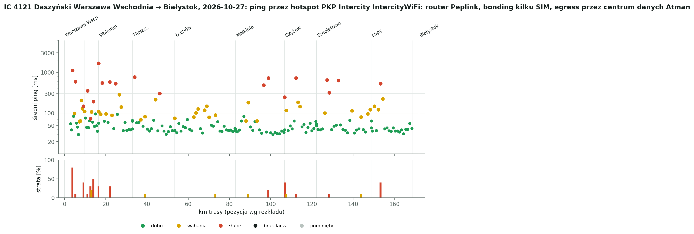
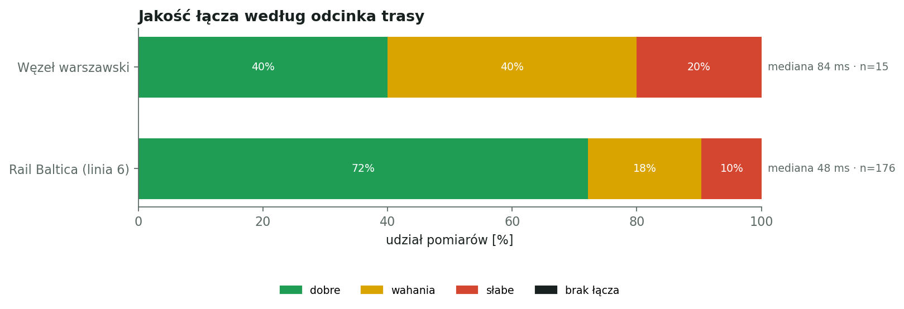
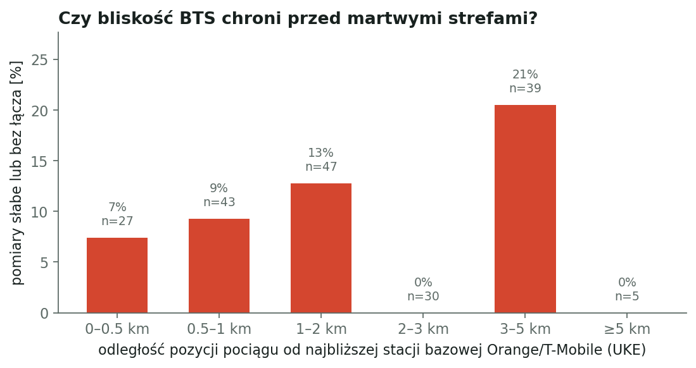

# IC 4121 Daszyński: Warszawa Wschodnia → Białystok, 2026-10-27

Pomiar jakości mobilnego internetu w pociągu: hotspot router Peplink (MAC d4:13:f8), do 4 modemów/SIM naraz, Wi-Fi 2,4 GHz, ok. -70 dBm, sieć PKP Intercity IntercityWiFi: router Peplink, bonding kilku SIM, egress przez centrum danych Atman. ping -c 10 -i 0.3 -W 2 co 30 s do 1.1.1.1. Pozycja pociągu z rozkładu jazdy i śladu GPS.

## Najważniejsze liczby

- pomiarów: **191** (+0 pominiętych jako zakłócone)
- dobre łącze: **70%** pomiarów, wahania 20%, słabe 10%, brak łącza 0%
- mediana średniego pingu: **49 ms**, 90. percentyl: 207 ms
- odcinków słabych lub bez łącza: **19**

## Odcinki trasy

| Odcinek | Pomiary | Dobre | Słabe + brak | Mediana pingu |
|---|---:|---:|---:|---:|
| Węzeł warszawski | 15 | 40% | 20% | 84 ms |
| Rail Baltica (linia 6) | 176 | 72% | 10% | 48 ms |

## Martwe i słabe strefy

| Czas | Gdzie (km) | Najgorszy pomiar | Najbliższy BTS |
|---|---|---|---|
| 21:14 | 4 km za st. Warszawa Wschodnia (km 4) | 1120 ms, strata 80% | T-Mobile 0.58 km (Warszawa) |
| 21:16 | 5 km przed st. Zielonka (km 5) | 587 ms, strata 10% | T-Mobile 1.26 km (Warszawa) |
| 21:20 | Zielonka (km 9) | 147 ms, strata 40% | Orange 0.29 km (Warszawa) |
| 21:22 | 1 km za st. Zielonka (km 11) | 351 ms, strata 10% | T-Mobile 0.8 km (Warszawa) |
| 21:23 | 3 km za st. Zielonka (km 13) | 73 ms, strata 30% | T-Mobile 1.26 km (Zielonka) |
| 21:25 | 2 km przed st. Wołomin (km 14) | 192 ms, strata 50% | Orange 1.09 km (Zielonka) |
| 21:27 | Wołomin (km 16) | 1660 ms, strata 30% | Orange 0.7 km (Wołomin) |
| 21:30 | 2 km za st. Wołomin (km 18) | 547 ms, strata 0% | T-Mobile 0.8 km (Wołomin) |
| 21:31 | 5 km za st. Wołomin (km 22) | 584 ms, strata 30% | T-Mobile 1.27 km (Wołomin) |
| 21:33 | 8 km przed st. Tłuszcz (km 25) | 531 ms, strata 0% | Orange 1.95 km (Duczki) |
| 21:39 | 1 km za st. Tłuszcz (km 34) | 764 ms, strata 0% | Orange 0.14 km (Tłuszcz) |
| 21:45 | 7 km przed st. Łochów (km 46) | 302 ms, strata 0% | Orange 1.71 km (Nowy Jadów) |
| 22:11 | 10 km przed st. Czyżew (km 97) | 487 ms, strata 0% | Orange 3.8 km (Szulborze-Koty) |
| 22:12 | 8 km przed st. Czyżew (km 99) | 729 ms, strata 20% | T-Mobile 3.15 km (Czyżew) |
| 22:16 | Czyżew (km 107) | 246 ms, strata 40% | T-Mobile 4.17 km (Czyżew) |
| 22:19 | 5 km za st. Czyżew (km 112) | 728 ms, strata 10% | T-Mobile 3.92 km (Szepietowo) |
| 22:28 | 5 km za st. Szepietowo (km 127) | 318 ms, strata 10% | Orange 3.48 km (Dworaki-Pikaty) |
| 22:30 | 11 km za st. Szepietowo (km 133) | 635 ms, strata 0% | Orange 3.29 km (Dworaki-Pikaty) |
| 22:41 | 5 km za st. Łapy (km 153) | 524 ms, strata 40% | Orange 3.32 km (Ignatki) |

## Którym operatorem szło łącze

Pokładowe Wi-Fi Intercity wychodzi do internetu kilkoma kartami SIM naraz; router przełącza ruch między operatorami. Co 30 s sprawdzamy publiczny adres IP łącza, czyli który modem obsługiwał ruch w tym momencie (próbka, nie przypisanie każdego pingu).

| Operator | Udział trasy | Mediana pingu | Słabo lub bez łącza |
|---|---:|---:|---:|
| inny | 100% | 49 ms | 10% |

## Stacje bazowe a jakość

Odległość liczona od szacowanej pozycji pociągu do najbliższej lokalizacji z pozwoleniem UKE (LTE 800/1800/2100/2600, 5G 2100). Pozwolenie nie oznacza, że stacja działa ani że świeci w stronę torów.

## Zastrzeżenia

- Od 21:06 przyjęto opóźnienie 5 min 0 s (zgłoszone przez pasażera: opóźnienie ok. 5 min).
- Odpowiedź później niż 2 s liczy się jako strata; intercitywifi (peplink) bonduje kilka kart sim w jeden tunel do huba atman, więc z publicznego ip ani z pojedynczego pingu nie wynika operator komórkowy backhaulu — podziału na operatorów dla tego przejazdu nie ma.
- Bez GPS pozycja jest liczona przy stałej prędkości między postojami, po prostej między stacjami; błąd sięga kilku km.
- Jeden telefon, jedna sieć, jeden przejazd: to obserwacja, nie pomiar referencyjny.

## Dziennik podróży

- przesiadka z EIC 3150 Tatry (Warszawa Wschodnia 20:31)
- opóźnienie ok. 5 min zgłoszone przez pasażera (odjazd z Wschodniej plan 21:06)
- 21:13 przełączenie na IntercityWiFi (inny system niż w Tatrach); egress przez Atman, operator komórkowy niewidoczny z IP
